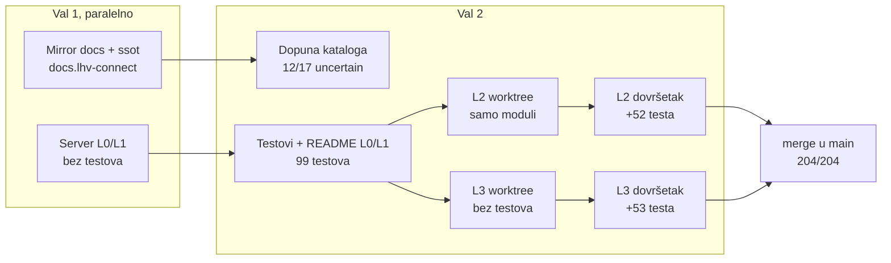
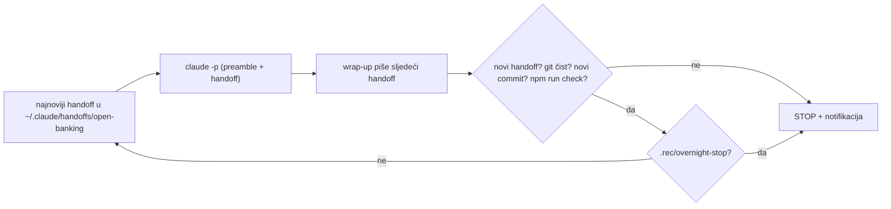

# Orkestracija subagenata: kako su nastali L0–L3 (2026-10-23)

Cijeli prvi dan projekta odradili su Opus 5.5 subagenti, a glavna sesija je samo
orkestrirala. Ovdje je ono što se ne vidi iz git povijesti: kako su valovi bili
posloženi, gdje su agenti stajali i zašto, te zamke koje je sljedeći prolaz ne bi
smio ponovno otkrivati.

Vezani dokumenti: [istraživanje i izvedivost](research/2026-10-23-lhv-connect-clients-and-feasibility.md),
[odluke](decisions.md), [TODO](../TODO.md), mirror specifikacije u
`/Users/ms/git/pinkainc/docs.lhv-connect` (README, `ssot/`).

## Tijek

| Agent | Effort | Poziva | Tokena konteksta | Ishod |
|---|---|---|---|---|
| Mirror + ssot | medium | 60 | 221k | gotovo, 17 operacija `uncertain` |
| Server L0/L1 | high | 52 | 192k | kod radi, 0 testova, bez README-a |
| Dopuna kataloga | medium | 60 | 222k | 12 od 17 riješeno |
| Testovi L0/L1 | high | 52 | 182k | 99/99, README |
| L2 prvi | high | 45 | 193k | samo moduli, nisu spojeni na server |
| L3 prvi | high | 42 | 192k | kod, 0 testova |
| L2 dovršetak | high | 58 | 173k | 151/151 |
| L3 dovršetak | high | 58 | 163k | 152/152 |

Ukupno 8 agenata i oko 430 poziva.

## Što je odredilo veličinu zadatka

- **Context guard (`~/.claude/hooks/context-guard.py`) zaustavlja agenta na oko 180k.**
  Svaki agent s high effortom stao je tamo, a ne na 250k iz prompta. Jedna cijela
  razina (implementacija, testovi i odluke) ne stane u jednog agenta. Pravilo koje je
  radilo: **jedan agent piše kod, drugi piše testove i spaja kod na server.** Tko
  planira, neka razinu odmah razbije na ta dva zadatka.
- Agent koji stane uredno commita i ostavi popis u izvještaju. Zato je nastavak
  kroz novog agenta s uskim zadatkom, kojem se kao kontekst da hash commita, bio
  jeftin.

## Zamke

1. **Mirror u worktreeju.** Test helperi su tražili `ROOT/../docs.lhv-connect`, što
   iz `.claude/worktrees/x` pokazuje krivo, a `reference/` je u `.gitignore`.
   Rezultat je bio 5 tiho preskočenih testova. Danas helper traži mirror penjući se
   prema gore (odluka 210), ili se zadaje `LHV_DOCS_DIR`.
2. **Worktree nema `node_modules`**, pa prije `npm run check` treba `npm ci`.
3. **Paralelne razine se sudaraju na istim mjestima** (`app.ts`, `emulator.ts`,
   `payments/engine.ts`, `decisions.md`, `fetch-reference.sh`, `reference.sha256`).
   Svi konflikti bili su aditivni, pa je rješenje uvijek bilo zadržati obje strane.
   Zato su odluke numerirane po razinama (L2 od 100, L3 od 200), a README i TODO
   agentima su bili zabranjeni i orkestrator ih je ažurirao nakon mergea.
4. **XML parser odbacuje atribut namespacea**, pa je svaki camt.060 bio
   `RequestInvalid`. Verzija se mora čitati iz imena elementa ili prefiksa, ne iz
   `xmlns`. Pronašao ga je tek agent koji je pisao testove.
5. **`fetch-reference.sh` nije skidao dva LHV primjera pain.002.** Bez mirrora su
   zato pala dva L1 testa. Vidljivo je tek na stroju bez mirrora, a CI bi bio takav.
6. **`X-Idempotency-Key` (odluka 28) postoji samo na UK hostu.** Agent za L0/L1 ga je
   uveo prije nego što je katalog EE/UK postojao. Otvoreno je u TODO-u.

## Što je ostalo otvoreno

- L4 (SEPA direct debit), L5 (VoP, FX, ugovori, webhookovi, messages v2), L6 (agency).
- UK flavour API-ja (`/accounts/*`, CoP, Bacs, HMAC webhookovi).
- Conformance harness: snimanje prema `connect.test.lhv.eu`. Treba pristup sandboxu
  (connect@lhv.ee, u ime firme), a skripta pitanja već postoji u
  `docs.lhv-connect/ssot/sandbox-questions.md` (29 pitanja).
- open-ledger kao pravi `Ledger` i pravi `Rails` bridgeovi.
- Katalog: sekcija o merchant reportu (P 13) nije pročitana, a nije provjereno ni
  podržava li UK CHAPS. Ostalo je 5 `uncertain` operacija.

## L4: SEPA direct debit (S1, 2026-10-23 navečer)

Prva sesija iz lanca `docs/handoffs/`. Plan je u `docs/2026-10-23-plan-do-paritete.md`.

| Agent | Effort | Poziva | Tokena konteksta | Ishod |
|---|---|---|---|---|
| L4 implementacija | high | 43 | 197k | moduli `server/src/directdebit/`, nespojeni, 0 testova, 0 odluka (`de08c4b`) |
| L4 testovi i spajanje | high | 48 | 189k | spojeno, +45 testova, dužnički testovi parkirani kao `.wip.ts`, 0 odluka |
| orkestrator, inline | — | ~15 | — | builder popravljen, +25 testova, odluke 300–318, sandbox pitanja 30–34 |

Podjela na dva agenta ovdje nije bila dovoljna. Razina DD-a ima dvije strane (vjerovnik
i dužnik), kalendar TARGET2 i tri vremenska prozora odbijanja, pa oba agenta stanu na
guardu. Odluke su ostale nenapisane jer su bile zadnje na popisu zadataka. Ostatak je
orkestrator dovršio sam, i to je bilo jeftinije od trećeg agenta.

Zamke:

1. **Agent je krivo dijagnosticirao parkirane testove.** Izvještaj je rekao da 16 testova
   pada zbog `GrpHdr/CtrlSum`. Pravi uzrok bio je da LHV-ov pain.007.001.09 XSD (EPC
   SDD Core C2PSP varijanta) traži i `GrpHdr/InitgPty` i `TxInf/OrgnlTxRef/MndtRltdInf`.
   Do toga se došlo ispisom pain.002 odgovora, a zatim `xmllint --noout --schema` nad
   generiranim zahtjevom. Pravilo: test builder prvo provući kroz xmllint, pa tek onda
   sumnjati na servis.
2. **CtrlSum mora biti zbroj iznosa**, a ne fiksnih `10.00`. Servis ga uspoređuje s
   iznosom naplate, pa testovi s 30, 500 i 5 EUR padaju na "Faulty control sum".
3. **Redoslijed provjera u `/_sim/direct-debit/incoming`:** VIBAN mora biti prije
   traženja vlasnika računa. Inače VIBAN dužnik dobije 404 umjesto 409 AG01 (odluka 312).
4. LHV-ovi XSD-ovi su stroži od ISO-a i neke provjere servisa čine nedostižnima
   (odluka 317). Testovi za te tekstove zato šalju prazne vrijednosti, a ne izostavljene
   elemente.

## L5a: JSON servisi EE (S2, 2026-10-23/24)

| Agent | Effort | Poziva | Tokena konteksta | Ishod |
|---|---|---|---|---|
| L5a implementacija | high | 58 | 198k | svih 9 operacija spojeno, 8 smoke testova, odluke 400–415 i 420–423, pitanja 35–41 (`ca55487`, `cb338ca`, `021c1c2`) |
| L5a testovi | high | 63 | 189k | +60 testova (342), primatelj webhookova preko pravog HTTP-a, popravak Jackson teksta, odluke 416–417 i 424, pitanje 42 |

Prva razina koja je stala u dva agenta bez dovršavanja u orkestratoru. Razlozi: guard je
podignut na 300k, pa nijedan agent nije bio rezan; JSON servisi nemaju XSD zamke; a
odluke su u promptu bile zadane *nakon svakog modula*, ne kao zadnji korak.

Zamke i nalazi:

1. **Sheme nisu u runtimeu.** `ssot/json-schemas/` je u mirroru koji se ne objavljuje, pa
   ih koriste samo testovi (ajv 2020-12, devDependency). Server sam validira i vraća LHV
   tekstove (odluka 400).
2. **Jacksonov tekst greške parsiranja** u P 12 primjeru citira zahtjev doslovno (pravi
   novi redovi i navodnici), a ne JSON-escapean. Prvi agent ga je escapeao; uhvatio ga je
   replay primjera u drugom agentu (odluka 417).
3. **camt.053 BkTxCd** se sad uzima iz knjiženja, što je usput promijenilo i DD stavke
   izvoda. Zato je dodan regresijski test u L4.
4. Isporuka webhooka ima injektabilan transport i `idle()`. Timeout od 10 s ostao je
   netestiran jer nije injektabilan.

## S3: dugovi L0–L3 i pending (2026-10-24, noćni rad)

Prvi put tri agenta po području, strogo jedan za drugim (bez worktreeja), svaki implementacija i testovi zajedno.

| Agent | Effort | Poziva | Tokena konteksta | Ishod |
|---|---|---|---|---|
| auth/http | high | 71 | 180k | flavour, grants, certifikati, kompresija, granice memorije; +47 testova, odluke 500–504, pitanja 43–45 |
| plaćanja | high | 96 | 218k | oneoff (404), pending, ručni pregled, ACWC, limiti, duplikati, cp1257, DD postavke; +36, odluke 520–527, pitanja 46–50 |
| izvodi | high | 66 | 157k | ISO XSD za .02/.06, VIBAN u camt.053, `PstlAdr`; +4, odluke 550–553, pitanje 51 |

Mali neovisni zadaci stanu u jednog agenta po području, bez drugog agenta za testove. Sekvencijalno radi bez konflikata, a svaki agent dobije u promptu nalaze prethodnoga (npr. da mirror nema camt.053.001.02 XSD).

Nalazi: `payment.oneoff` je LHV uklonio (P 01 changelog), pa plan za +1 operaciju ne vrijedi; PAYMENT_MULTI ponavlja InstrId pa duplikat ne može biti samo InstrId; iso20022.org stranice vraćaju 403 skriptama, ali `.xsd` datoteke se skidaju izravno; xmllint-wasm treba 1 GiB za stranicu od 10 000 stavki.

## S4: provjera primatelja i messages v2 (2026-10-24, noćni rad)

Dva agenta strogo jedan za drugim, svaki implementacija i testovi zajedno.

| Agent | Effort | Poziva | Tokena konteksta | Ishod |
|---|---|---|---|---|
| VoP/CoP requester | high | ~43 | 151k | 3 operacije + `test.accounts.ibans`, +18 testova, odluke 600–610, pitanja 52–55 |
| messages v2 + requests | high | 60 | 179k | 5 operacija (`test.next` je već bio gotov), +36 testova, odluke 620–632, pitanja 56–61 |

Nalazi:

1. **API 529 Overloaded tri puta zaredom** prekinuo je prvog agenta. Nastavak preko
   `SendMessage` istom agentu (kontekst ostaje) radio je; posao nije izgubljen jer je
   radno stablo ostalo netaknuto. U promptu nastavka treba reći što je na disku i da
   prvo commita zeleni korak.
2. **Nijedan servis nije pamtio tijelo zahtjeva**, pa je `GET /v2/requests/{id}` tražio
   novi dnevnik. Lokalni `accepted()` helperi (app, payee, fx, viban, DD) spojeni su u
   jedan u `requests.ts`. Prvi agent je to uočio i predao drugome u izvještaju, što je
   uštedjelo istraživanje.
3. Jedno stanje za v1 i v2 promijenilo je v1 ponašanje: ponovljeni DELETE daje 200 dok
   je poruka u tjednoj arhivi obrađenih (odluka 621).

## S5: UK flavour (2026-10-24, noćni rad)

Tri agenta strogo jedan za drugim, bez worktreeja, svaki implementacija i testovi zajedno.
Bacs je stao u istu sesiju, pa S5b nije trebao.

| Agent | Effort | Poziva | Tokena konteksta | Ishod |
|---|---|---|---|---|
| accounts + routing | high | 73 | 212k | 3 operacije, `routing.ts`, UK vrijeme heartbeata; +24 testa, odluke 700–714, pitanja 62–66 |
| UK webhookovi | high | 43 | 180k | 8 operacija, HMAC jednak golden vektoru; +31, odluke 720–729, pitanja 67–70 |
| Bacs | high | 82 | 244k | 5 operacija, kalendar Engleske i Walesa, Bacs XSD-ovi u `fetch-reference.sh`; +17, odluke 740–749, pitanja 71–76 |

Nalazi:

1. **Routing kao `onRoute` pravilo** umjesto provjera po servisu: prvi agent je unaprijed
   upisao putanje sljedećih dvaju agenata u `UK_ONLY`, pa webhookovi i Bacs nisu morali
   dirati routing. Cijena: EE-only servisi na UK hostu bez `LHVEE` sad su 404, pa su tri
   stara testa dobila header.
2. **Predaja između agenata kroz izvještaj** opet je radila: tipovi poruka i `inbox.add`
   okidač za webhookove, koje je drugi agent javio, trećem su uštedjeli istraživanje.
3. **Dokumentacija za UK webhookove je proturječna**: JSON primjeri koriste
   `regCode`/`regCodeIssuer`, a HMAC vektor iz webhook-security.md `clientCode`/`clientCountry`.
   Golden vrijednost daje samo druga varijanta (odluka 721).
4. **G-ovi primjeri nisu uvijek valjani**: JSON bez zareza, pain.012 bez `OrgnlMsgInf/MsgNmId`,
   `Accptd` „0” za prihvat. Testovi popravljaju primjer i zapisuju odstupanje.
5. Mirror je imao necommitana pitanja 52–61 iz S4; orkestrator ih je commitao lokalno
   (zajedno sa 62–66). Agente treba izričito pustiti da commitaju u mirror.

## S6: L6 agency i ostatak kataloga (2026-10-24, noćni rad)

Dva agenta strogo jedan za drugim, bez worktreeja, svaki implementacija i testovi zajedno.
S ovom sesijom katalog je pokriven: 57/58, a `payment.oneoff` je namjerni 404 (odluka 520).

| Agent | Effort | Poziva | Tokena konteksta | Ishod |
|---|---|---|---|---|
| agency sync + responderi | high | 78 | 244k | 5 operacija (sync v1/v2, RTF, CoP/VoP incoming), `server/src/agency/`; +27 testova, odluke 800–813, pitanja 77–83 |
| merchant report, agency plaćanja, PSP | high | 111 | 274k | `acq.merchant_report` (P 13), plaćanja s/na agency račune, G use caseovi 1–8 kao e2e lanci; +20, odluke 820–849, pitanja 84–86 |

Nalazi:

1. **Predaja kroz izvještaj opet je radila.** Prvi agent je unaprijed dizajnirao agency store
   (`get`, `find`, `agencyKey`, `rangeFor`, `receivable`) za drugoga i to je drugi koristio bez
   istraživanja.
2. **Objavljeni primjeri imaju krive IBAN kontrolne brojeve** (sedam komada u agency, VoP i
   PSP primjerima). Emulator ih odbija kao `INVALID_IBAN`; testovi koriste ispravljene, osim
   gdje se račun nalazi po sort codeu.
3. **Sedam od osam RTF zipova je zaključano lozinkom**, pa se formati EBA STEP2/RT1 ne mogu
   pročitati; čitljiv je samo TARGET2.
4. **E2e lanci su mijenjali postojeći izlaz**: pain.002 bez `OrgnlEndToEndId`, adresa VIBAN
   vlasnika samo ulica, identitet LHV UK (BIC, ime, adresa, UK vrijeme) za GB račune. Stari
   testovi su prilagođeni; promjene su na popisu „Za pregled ujutro”.
5. Drugi agent je stao blizu guarda (274k) sa 111 poziva. Tri teme u jednom agentu je gornja
   granica; za S7 (Postgres) je bolje dva agenta po storeu.

## S7: trajnost i jezgra (2026-10-24, noćni rad)

Sedam agenata strogo jedan za drugim (bez worktreeja), Opus 5.5, effort high.

| Agent | Poziva | Tokena | Ishod |
|---|---|---|---|
| A inbox u Postgresu | 83 | 167k | async `InboxStore`, `PgInbox`, `dev-db.sh`, 667 testova (900–907) |
| B ledger u Postgresu | 48 | 121k | `PgLedger`, cijeli suite dvaput (memory, Postgres), 691 ×2 (910–918) |
| C open-ledger kao `Ledger` | 54 | 151k | HTTP + ed25519 bez SDK-a, hold wallet po računu, treći korak checka 21 (920–928) |
| D `Rails` za bridge | 42 | 139k | `accepted` + `RailsEvents`, `HttpRails`, protokol, 716 ×2 (930–938) |
| E agency i acquiring | 77 | 190k | async storeovi + Pg, pending rails nakon restarta, 722 ×2 (940–949) |
| F partner PSP primjeri | 74 | 190k | case1..8 replayani, nijedan točno, razlike potvrđene; pitanje 87 (950–955) |
| G journal i payment engine | 94 | 179k | journal, `KeyedStore`, duplikati, parkirana plaćanja, DD MsgId, 745 ×2 (960–967) |

Što se pokazalo:

- **Postgres run je pao nula puta na prvom pokretanju** jer je korak A odmah pretvorio sve
  pozive inboxa u `await` i provjerio ih odgođenim inboxom. Pravi bugovi bili su drugdje:
  MemoryLedger je kod paralelnih rezervacija prekoračivao saldo (913), a perzistentni ledger
  je na svakom startu ponovno financirao seed (914).
- **Detektor propuštenih awaita** mora imati nasumična kašnjenja (E): s fiksnim kašnjenjem
  timeri se izvrše redom i propušteni await na pisanju prođe.
- Svaki agent je stao ispod guarda (121k–190k) jer je zadatak bio jedno područje stanja.
  Za S7b isti rez: jedno do dva područja po agentu.
- Sve poslovno stanje nije stalo u S7, pa je umetnut S7b (odluka 968).

## S7b: ostatak trajnog stanja (2026-10-24, danju)

Glavna sesija je orkestrirala sedam agenata strogo jednog za drugim (bez worktreeja), Opus 5.5, effort high. Korisnik je odobrio paket i pustio rad autonomno.

| Agent | Poziva | Tokena | Ishod |
|---|---|---|---|
| A direktorij klijenata i računa | 94 | 188k | async `DirectoryStore` + `PgDirectory`, svi pozivatelji `await`, 748 ×2 (970–974) |
| B SEPA DD naplate i Bacs | 65 | 190k | keyed vrste + `replace`, claim po stavci, popravak idempotency ključa pod `deferred` (979), 757 ×2 (975–979) |
| C FX, ugovori, VIBAN-i | 75 | 185k | keyed vrste, brojevi VIBAN-a i FX deal brojevi jedinstveni preko dva emulatora, 766 ×2 (980–984) |
| D webhookovi, UK izvještaji, logovi | 103 | 212k | retry webhooka jednom nakon restarta, Bacs „Pending” nakon restarta, 774 ×2 (985–989) |
| E outbox i inbox | 92 | 234k | outbox u transakciji knjiženja, `recover()`; gubitak poruka iz inboxa se nije dao reproducirati (993), 781 ×2 (990–994) |
| F idempotentna knjiženja | 75 | 200k | ključ knjiženja na sva tri ledgera, `ledger_bookings`, izvještaji u outboxu, 794 ×2 (995–999) |
| G rails povrati i rekonsilijacija | 79 | 205k | camt.056, DD povrati, `GET /payments/{ref}`, prvi ishod pobjeđuje, `deferred` u checku, 817 ×2 + 690 (1000–1004) |

Što se pokazalo:

- **Agent F nije bio u planu.** Agent E je našao stariju rupu koja se tiče novca: pad nakon knjiženja, a prije spremanja stanja servisa, knjižio bi ponovno. Orkestrator je umetnuo F prije railsa. Nalaz jednog agenta treba odmah prebaciti u brief sljedećeg, ne ostaviti za handoff.
- **Nalaz agenta nije činjenica.** C je javio da se pri pražnjenju inboxa iz dva emulatora gube poruke. E to nije mogao reproducirati: dva čitača vide istu najstariju poruku, kako LHV red i radi. Prije popravka treba reproducirajući test.
- Svi agenti su završili ispod guarda (185k–234k) s jednim do pet manjih područja po agentu. E i F su bili najbliže granici jer su dirali sva mjesta knjiženja.
- `deferred` je korak checka paralelno s memory i Postgres runom, pa check traje oko 1 min 40 s umjesto 80 s.

## S7c: otvorene core stavke (2026-10-25, danju)

Sandbox certifikata još nema, pa je korisnik umjesto S8 izabrao tri otvorene stavke iz „Core and conformance” i pustio rad autonomno. Tri agenta strogo jedan za drugim, Opus 5.5, effort high, svaki implementira i testira.

| Agent | Poziva | Tokena | Ishod |
|---|---|---|---|
| 1 pain.002 kruga nakon pada | 53 | 180k | plan kruga u outboxu prije knjiženja, recovery dovrši krug, `payment-decided` za parkirane odluke, DD RJCT u outboxu, 829 ×2 (1005–1007) |
| 2 last-write-wins | 57 | 151k | `replace(key, value, expected)`, `updateKeyed`, `claimName`; svaki slučaj prvo reproduciran testom s dva emulatora; uzrok flakea u `pg-contracts` (seed ugovora), 847 ×2 (1008–1013) |
| 3 povrat vlastitog plaćanja | 66 | 173k | `payment.returned`, `payment-settled` zapis kroz outbox pri namiri, camt.054 po LHV uzorku povrata umjesto ISO koda, party na recall debitu, pitanje 90, 857 ×2 + 715 (1014–1016) |

Što se pokazalo:

- Jedno područje po agentu staje u 150–180k, dakle ispod S7b agenata s više područja.
- Uputa „prvo reproduciraj, pa popravi” je radila: agent 2 je za svako mjesto imao crveni test prije popravka i našao pravi uzrok flakea, a ne samo dulji timeout.
- Prvi check nakon agenta 1 pao je na jednom memory testu (log se prepisao); dva ponovljena checka bila su zelena. Brief agenta 2 dobio je flake kao sporedni zadatak i pokazalo se da je bio stvaran.
- Agent 3 je odstupio od briefa gdje je dokumentacija imala uzorak (PMNT/RCDT/OTHR s RvslInd umjesto ISO PMNT/ICDT/RRTN): dokumentacija ima prednost pred pretpostavkom u briefu.

## S7d: preostale core rupe (2026-10-30, danju)

Upit za sandbox je poslan isti dan, pa je S7d umetnut prije S8. Šest agenata strogo jedan za drugim, Opus 5.5, effort high, svaki implementira i testira, svaki prima nalaze prethodnoga u briefu.

| Agent | Poziva | Tokena | Ishod |
|---|---|---|---|
| 1 pad tijekom provjera pain.001 | 32 | 122k | datoteka u outboxu prije MsgId-a, MsgId kao claim, `#resumeFile`, pitanje 91, 862 ×2 (1017) |
| 2 krugovi nakon izvještaja (stavke 2 i 3) | 42 | 158k | plan sljedećeg kruga u istom outbox putu, `Step.then: Plan`, trenutni ishod uzima zapis zadnji, 875 ×2 (1018) |
| 3 callback ishodi RJCT/ACWC | 34 | 132k | outbox put prije `take`, id sljedećeg kruga izveden hashom (`afterOf`), našao istu rupu u trenutnom ACWC-u, 884 ×2 (1019) |
| 4 povrat plaćanja prije 1014 | 50 | 125k | zapis izveden lijeno iz camt.054 u journalu (`JournalStore.byRef`), bez backfilla, 891 ×2 (1020) |
| 5 pad tijekom provjera pain.008 | 41 | 145k | obrazac iz 1017 za DD, zajednički `claimKey` u `keyed.ts`, pitanje 92, 901 ×2 (1021) |
| 6 pain.007 i camt.060 | 45 | 158k | isti obrazac za DD odbijanje i zahtjeve za izvod, atomski claim MsgId-a, 931 ×2 + 761 (1022–1023) |

Što se pokazalo:

- Stavke 4 i 5 iz briefa nisu bile na početnom popisu: rupu u callback ishodima prijavio je agent 2, rupu u DD datoteci agent 1, a pain.007 i camt.060 agent 5. Pitanje „što još ima istu rupu” na kraju briefa isplatilo se triput.
- Stavke 2 i 3 dane su jednom agentu jer je agent 1 pokazao da ih zatvara isti mehanizam; stalo je u 158k.
- Svi agenti 120–160k, nijedan blizu guarda. Ukupno ~840k tokena subagenata, oko 1 h 05 min rada agenata.
- Svaki popravak imao je crveni test prije (ukupno 74 nova testa, gotovo svi padali na staroj verziji); utrka dvaju zahtjeva za izvod ne reproducira se na čistom memory storeu, samo na deferredu i Postgresu.

## Noćni lanac: `scripts/overnight.sh` (2026-10-24)

S3–S7 su odrađeni bez čovjeka, od 01:03 do 06:18. Svaku sesiju je pokrenula shell petlja kao
svježi `claude -p`, a glavna sesija je samo čekala da skripta završi.

**Zašto `claude -p`, a ne subagent glavne sesije.** Svaka sesija i sama orkestrira
subagente (implementacija pa testovi), a subagent ne može pokretati vlastite subagente.
Kao subagent, sesija bi cijeli paket morala odraditi u jednom kontekstu, a to je na L0–L4
udaralo u context guard. `claude -p` je prava sesija: ima Agent tool, skillove, hookove i
compaction.

**Preamble** koji skripta stavlja ispred handoffa: subagenti strogo jedan po jedan (bez
worktreeja i Workflowa), bez Monitora i buđenja, korisnikove odluke konzervativno uz oznaku
„(noćni rad, potvrditi)” i stavku u TODO „Za pregled ujutro”, razlog za čovjeka u
`.rec/overnight-stop`, na kraju `wrap-up`.

| Sesija | Trajanje | Potezi orkestratora | API-ekviv. | Testovi nakon |
|---|---|---|---|---|
| S3 | 52 min | 25 | $13,6 | 429 |
| S4 | 16 min | 16 | $8,1 | 483 |
| S5 | 48 min | 28 | $14,4 | 555 |
| S6 | 46 min | 21 | $13,5 | 602 |
| S7 | 108 min | 35 | $25,7 | 745 ×2 + 21 |

Ukupno oko $75 i 5 sati. Nijedna sesija nije stala na limitu, pa nastavak nakon limita
(`--resume`, 60 min čekanja, najviše 3 puta) još nije isproban.

Zamke:
- Skripta mora krenuti s čistim gitom, pa svaku izmjenu skripte treba commitati prije
  pokretanja. Dok lanac radi, repo se ne dira.
- Iz Claude Code sesije pokretati s `env -u CLAUDECODE -u CLAUDE_CODE_ENTRYPOINT`.
- `claude -p` se ne vidi kao subagent. Napredak pokazuje `~/.claude/overnight-status.sh`
  (commitovi, subagenti s vremenom zadnjeg pisanja, zadnji koraci). Sesiju koja radi ne
  otvarati s `claude --resume`.
- Sažetak čita brojke testova iz `check.sh`. Kad je S7 počeo uvlačiti ispis, redak je
  ostao prazan iako je check prošao (popravljeno u `3c21df4`).
- Logovi i sažetak: `.rec/overnight/<vrijeme>/summary.md`, `session-N.json` (rezultat,
  trošak, `session_id`), `check-N.log`.
