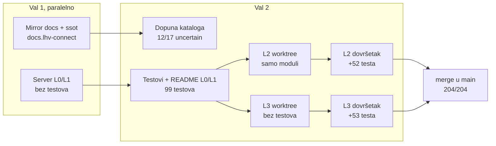

# Orkestracija subagenata: kako su nastali L0–L3 (2026-10-23)

Cijeli prvi dan projekta odradili su Opus 5.5 subagenti, a glavna sesija je samo
orkestrirala. Ovdje je ono što se ne vidi iz git povijesti: kako su valovi bili
posloženi, gdje su agenti stajali i zašto, te zamke koje je sljedeći prolaz ne bi
smio ponovno otkrivati.

Vezani dokumenti: [istraživanje i izvedivost](research/2026-10-23-lhv-connect-clients-and-feasibility.md),
[odluke](decisions.md), [TODO](../TODO.md), mirror specifikacije u
`/Users/ms/git/pinkainc/docs.lhv-connect` (README, `ssot/`).

## Tijek

| Agent | Effort | Poziva | Tokena konteksta | Ishod |
|---|---|---|---|---|
| Mirror + ssot | medium | 60 | 221k | gotovo, 17 operacija `uncertain` |
| Server L0/L1 | high | 52 | 192k | kod radi, 0 testova, bez README-a |
| Dopuna kataloga | medium | 60 | 222k | 12 od 17 riješeno |
| Testovi L0/L1 | high | 52 | 182k | 99/99, README |
| L2 prvi | high | 45 | 193k | samo moduli, nisu spojeni na server |
| L3 prvi | high | 42 | 192k | kod, 0 testova |
| L2 dovršetak | high | 58 | 173k | 151/151 |
| L3 dovršetak | high | 58 | 163k | 152/152 |

Ukupno 8 agenata i oko 430 poziva.

## Što je odredilo veličinu zadatka

- **Context guard (`~/.claude/hooks/context-guard.py`) zaustavlja agenta na oko 180k.**
  Svaki agent s high effortom stao je tamo, a ne na 250k iz prompta. Jedna cijela
  razina (implementacija, testovi i odluke) ne stane u jednog agenta. Pravilo koje je
  radilo: **jedan agent piše kod, drugi piše testove i spaja kod na server.** Tko
  planira, neka razinu odmah razbije na ta dva zadatka.
- Agent koji stane uredno commita i ostavi popis u izvještaju. Zato je nastavak
  kroz novog agenta s uskim zadatkom, kojem se kao kontekst da hash commita, bio
  jeftin.

## Zamke

1. **Mirror u worktreeju.** Test helperi su tražili `ROOT/../docs.lhv-connect`, što
   iz `.claude/worktrees/x` pokazuje krivo, a `reference/` je u `.gitignore`.
   Rezultat je bio 5 tiho preskočenih testova. Danas helper traži mirror penjući se
   prema gore (odluka 210), ili se zadaje `LHV_DOCS_DIR`.
2. **Worktree nema `node_modules`**, pa prije `npm run check` treba `npm ci`.
3. **Paralelne razine se sudaraju na istim mjestima** (`app.ts`, `emulator.ts`,
   `payments/engine.ts`, `decisions.md`, `fetch-reference.sh`, `reference.sha256`).
   Svi konflikti bili su aditivni, pa je rješenje uvijek bilo zadržati obje strane.
   Zato su odluke numerirane po razinama (L2 od 100, L3 od 200), a README i TODO
   agentima su bili zabranjeni i orkestrator ih je ažurirao nakon mergea.
4. **XML parser odbacuje atribut namespacea**, pa je svaki camt.060 bio
   `RequestInvalid`. Verzija se mora čitati iz imena elementa ili prefiksa, ne iz
   `xmlns`. Pronašao ga je tek agent koji je pisao testove.
5. **`fetch-reference.sh` nije skidao dva LHV primjera pain.002.** Bez mirrora su
   zato pala dva L1 testa. Vidljivo je tek na stroju bez mirrora, a CI bi bio takav.
6. **`X-Idempotency-Key` (odluka 28) postoji samo na UK hostu.** Agent za L0/L1 ga je
   uveo prije nego što je katalog EE/UK postojao. Otvoreno je u TODO-u.

## Što je ostalo otvoreno

- L4 (SEPA direct debit), L5 (VoP, FX, ugovori, webhookovi, messages v2), L6 (agency).
- UK flavour API-ja (`/accounts/*`, CoP, Bacs, HMAC webhookovi).
- Conformance harness: snimanje prema `connect.test.lhv.eu`. Treba pristup sandboxu
  (connect@lhv.ee, u ime firme), a skripta pitanja već postoji u
  `docs.lhv-connect/ssot/sandbox-questions.md` (29 pitanja).
- open-ledger kao pravi `Ledger` i pravi `Rails` bridgeovi.
- Katalog: sekcija o merchant reportu (P 13) nije pročitana, a nije provjereno ni
  podržava li UK CHAPS. Ostalo je 5 `uncertain` operacija.

## L4: SEPA direct debit (S1, 2026-10-23 navečer)

Prva sesija iz lanca `docs/handoffs/`. Plan je u `docs/2026-10-23-plan-do-paritete.md`.

| Agent | Effort | Poziva | Tokena konteksta | Ishod |
|---|---|---|---|---|
| L4 implementacija | high | 43 | 197k | moduli `server/src/directdebit/`, nespojeni, 0 testova, 0 odluka (`de08c4b`) |
| L4 testovi i spajanje | high | 48 | 189k | spojeno, +45 testova, dužnički testovi parkirani kao `.wip.ts`, 0 odluka |
| orkestrator, inline | — | ~15 | — | builder popravljen, +25 testova, odluke 300–318, sandbox pitanja 30–34 |

Podjela na dva agenta ovdje nije bila dovoljna. Razina DD-a ima dvije strane (vjerovnik
i dužnik), kalendar TARGET2 i tri vremenska prozora odbijanja, pa oba agenta stanu na
guardu. Odluke su ostale nenapisane jer su bile zadnje na popisu zadataka. Ostatak je
orkestrator dovršio sam, i to je bilo jeftinije od trećeg agenta.

Zamke:

1. **Agent je krivo dijagnosticirao parkirane testove.** Izvještaj je rekao da 16 testova
   pada zbog `GrpHdr/CtrlSum`. Pravi uzrok bio je da LHV-ov pain.007.001.09 XSD (EPC
   SDD Core C2PSP varijanta) traži i `GrpHdr/InitgPty` i `TxInf/OrgnlTxRef/MndtRltdInf`.
   Do toga se došlo ispisom pain.002 odgovora, a zatim `xmllint --noout --schema` nad
   generiranim zahtjevom. Pravilo: test builder prvo provući kroz xmllint, pa tek onda
   sumnjati na servis.
2. **CtrlSum mora biti zbroj iznosa**, a ne fiksnih `10.00`. Servis ga uspoređuje s
   iznosom naplate, pa testovi s 30, 500 i 5 EUR padaju na "Faulty control sum".
3. **Redoslijed provjera u `/_sim/direct-debit/incoming`:** VIBAN mora biti prije
   traženja vlasnika računa. Inače VIBAN dužnik dobije 404 umjesto 409 AG01 (odluka 312).
4. LHV-ovi XSD-ovi su stroži od ISO-a i neke provjere servisa čine nedostižnima
   (odluka 317). Testovi za te tekstove zato šalju prazne vrijednosti, a ne izostavljene
   elemente.
