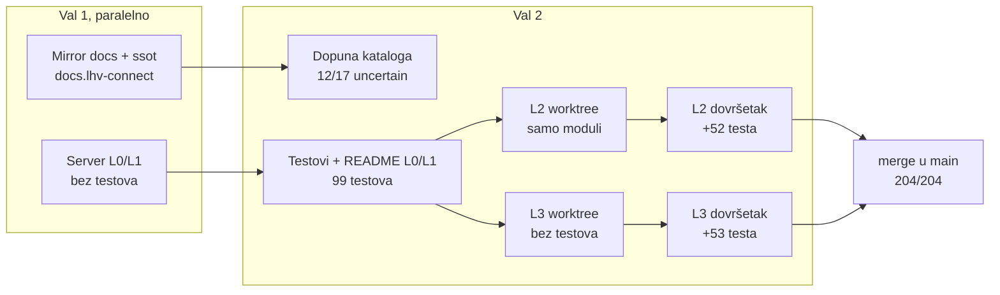

# Orkestracija subagenata: kako su nastali L0–L3 (2026-10-23)

Cijeli prvi dan projekta odradili su Opus 5.5 subagenti, a glavna sesija je samo
orkestrirala. Ovdje je ono što se ne vidi iz git povijesti: kako su valovi bili
posloženi, gdje su agenti stajali i zašto, te zamke koje je sljedeći prolaz ne bi
smio ponovno otkrivati.

Vezani dokumenti: [istraživanje i izvedivost](research/2026-10-23-lhv-connect-clients-and-feasibility.md),
[odluke](decisions.md), [TODO](../TODO.md), mirror specifikacije u
`/Users/ms/git/pinkainc/docs.lhv-connect` (README, `ssot/`).

## Tijek

| Agent | Effort | Poziva | Tokena konteksta | Ishod |
|---|---|---|---|---|
| Mirror + ssot | medium | 60 | 221k | gotovo, 17 operacija `uncertain` |
| Server L0/L1 | high | 52 | 192k | kod radi, 0 testova, bez README-a |
| Dopuna kataloga | medium | 60 | 222k | 12 od 17 riješeno |
| Testovi L0/L1 | high | 52 | 182k | 99/99, README |
| L2 prvi | high | 45 | 193k | samo moduli, nisu spojeni na server |
| L3 prvi | high | 42 | 192k | kod, 0 testova |
| L2 dovršetak | high | 58 | 173k | 151/151 |
| L3 dovršetak | high | 58 | 163k | 152/152 |

Ukupno 8 agenata i oko 430 poziva.

## Što je odredilo veličinu zadatka

- **Context guard (`~/.claude/hooks/context-guard.py`) zaustavlja agenta na oko 180k.**
  Svaki agent s high effortom stao je tamo, a ne na 250k iz prompta. Jedna cijela
  razina (implementacija, testovi i odluke) ne stane u jednog agenta. Pravilo koje je
  radilo: **jedan agent piše kod, drugi piše testove i spaja kod na server.** Tko
  planira, neka razinu odmah razbije na ta dva zadatka.
- Agent koji stane uredno commita i ostavi popis u izvještaju. Zato je nastavak
  kroz novog agenta s uskim zadatkom, kojem se kao kontekst da hash commita, bio
  jeftin.

## Zamke

1. **Mirror u worktreeju.** Test helperi su tražili `ROOT/../docs.lhv-connect`, što
   iz `.claude/worktrees/x` pokazuje krivo, a `reference/` je u `.gitignore`.
   Rezultat je bio 5 tiho preskočenih testova. Danas helper traži mirror penjući se
   prema gore (odluka 210), ili se zadaje `LHV_DOCS_DIR`.
2. **Worktree nema `node_modules`**, pa prije `npm run check` treba `npm ci`.
3. **Paralelne razine se sudaraju na istim mjestima** (`app.ts`, `emulator.ts`,
   `payments/engine.ts`, `decisions.md`, `fetch-reference.sh`, `reference.sha256`).
   Svi konflikti bili su aditivni, pa je rješenje uvijek bilo zadržati obje strane.
   Zato su odluke numerirane po razinama (L2 od 100, L3 od 200), a README i TODO
   agentima su bili zabranjeni i orkestrator ih je ažurirao nakon mergea.
4. **XML parser odbacuje atribut namespacea**, pa je svaki camt.060 bio
   `RequestInvalid`. Verzija se mora čitati iz imena elementa ili prefiksa, ne iz
   `xmlns`. Pronašao ga je tek agent koji je pisao testove.
5. **`fetch-reference.sh` nije skidao dva LHV primjera pain.002.** Bez mirrora su
   zato pala dva L1 testa. Vidljivo je tek na stroju bez mirrora, a CI bi bio takav.
6. **`X-Idempotency-Key` (odluka 28) postoji samo na UK hostu.** Agent za L0/L1 ga je
   uveo prije nego što je katalog EE/UK postojao. Otvoreno je u TODO-u.

## Što je ostalo otvoreno

- L4 (SEPA direct debit), L5 (VoP, FX, ugovori, webhookovi, messages v2), L6 (agency).
- UK flavour API-ja (`/accounts/*`, CoP, Bacs, HMAC webhookovi).
- Conformance harness: snimanje prema `connect.test.lhv.eu`. Treba pristup sandboxu
  (connect@lhv.ee, u ime firme), a skripta pitanja već postoji u
  `docs.lhv-connect/ssot/sandbox-questions.md` (29 pitanja).
- open-ledger kao pravi `Ledger` i pravi `Rails` bridgeovi.
- Katalog: sekcija o merchant reportu (P 13) nije pročitana, a nije provjereno ni
  podržava li UK CHAPS. Ostalo je 5 `uncertain` operacija.

## L4: SEPA direct debit (S1, 2026-10-23 navečer)

Prva sesija iz lanca `docs/handoffs/`. Plan je u `docs/2026-10-23-plan-do-paritete.md`.

| Agent | Effort | Poziva | Tokena konteksta | Ishod |
|---|---|---|---|---|
| L4 implementacija | high | 43 | 197k | moduli `server/src/directdebit/`, nespojeni, 0 testova, 0 odluka (`de08c4b`) |
| L4 testovi i spajanje | high | 48 | 189k | spojeno, +45 testova, dužnički testovi parkirani kao `.wip.ts`, 0 odluka |
| orkestrator, inline | — | ~15 | — | builder popravljen, +25 testova, odluke 300–318, sandbox pitanja 30–34 |

Podjela na dva agenta ovdje nije bila dovoljna. Razina DD-a ima dvije strane (vjerovnik
i dužnik), kalendar TARGET2 i tri vremenska prozora odbijanja, pa oba agenta stanu na
guardu. Odluke su ostale nenapisane jer su bile zadnje na popisu zadataka. Ostatak je
orkestrator dovršio sam, i to je bilo jeftinije od trećeg agenta.

Zamke:

1. **Agent je krivo dijagnosticirao parkirane testove.** Izvještaj je rekao da 16 testova
   pada zbog `GrpHdr/CtrlSum`. Pravi uzrok bio je da LHV-ov pain.007.001.09 XSD (EPC
   SDD Core C2PSP varijanta) traži i `GrpHdr/InitgPty` i `TxInf/OrgnlTxRef/MndtRltdInf`.
   Do toga se došlo ispisom pain.002 odgovora, a zatim `xmllint --noout --schema` nad
   generiranim zahtjevom. Pravilo: test builder prvo provući kroz xmllint, pa tek onda
   sumnjati na servis.
2. **CtrlSum mora biti zbroj iznosa**, a ne fiksnih `10.00`. Servis ga uspoređuje s
   iznosom naplate, pa testovi s 30, 500 i 5 EUR padaju na "Faulty control sum".
3. **Redoslijed provjera u `/_sim/direct-debit/incoming`:** VIBAN mora biti prije
   traženja vlasnika računa. Inače VIBAN dužnik dobije 404 umjesto 409 AG01 (odluka 312).
4. LHV-ovi XSD-ovi su stroži od ISO-a i neke provjere servisa čine nedostižnima
   (odluka 317). Testovi za te tekstove zato šalju prazne vrijednosti, a ne izostavljene
   elemente.

## L5a: JSON servisi EE (S2, 2026-10-23/24)

| Agent | Effort | Poziva | Tokena konteksta | Ishod |
|---|---|---|---|---|
| L5a implementacija | high | 58 | 198k | svih 9 operacija spojeno, 8 smoke testova, odluke 400–415 i 420–423, pitanja 35–41 (`ca55487`, `cb338ca`, `021c1c2`) |
| L5a testovi | high | 63 | 189k | +60 testova (342), primatelj webhookova preko pravog HTTP-a, popravak Jackson teksta, odluke 416–417 i 424, pitanje 42 |

Prva razina koja je stala u dva agenta bez dovršavanja u orkestratoru. Razlozi: guard je
podignut na 300k, pa nijedan agent nije bio rezan; JSON servisi nemaju XSD zamke; a
odluke su u promptu bile zadane *nakon svakog modula*, ne kao zadnji korak.

Zamke i nalazi:

1. **Sheme nisu u runtimeu.** `ssot/json-schemas/` je u mirroru koji se ne objavljuje, pa
   ih koriste samo testovi (ajv 2020-12, devDependency). Server sam validira i vraća LHV
   tekstove (odluka 400).
2. **Jacksonov tekst greške parsiranja** u P 12 primjeru citira zahtjev doslovno (pravi
   novi redovi i navodnici), a ne JSON-escapean. Prvi agent ga je escapeao; uhvatio ga je
   replay primjera u drugom agentu (odluka 417).
3. **camt.053 BkTxCd** se sad uzima iz knjiženja, što je usput promijenilo i DD stavke
   izvoda. Zato je dodan regresijski test u L4.
4. Isporuka webhooka ima injektabilan transport i `idle()`. Timeout od 10 s ostao je
   netestiran jer nije injektabilan.

## S3: dugovi L0–L3 i pending (2026-10-24, noćni rad)

Prvi put tri agenta po području, strogo jedan za drugim (bez worktreeja), svaki implementacija i testovi zajedno.

| Agent | Effort | Poziva | Tokena konteksta | Ishod |
|---|---|---|---|---|
| auth/http | high | 71 | 180k | flavour, grants, certifikati, kompresija, granice memorije; +47 testova, odluke 500–504, pitanja 43–45 |
| plaćanja | high | 96 | 218k | oneoff (404), pending, ručni pregled, ACWC, limiti, duplikati, cp1257, DD postavke; +36, odluke 520–527, pitanja 46–50 |
| izvodi | high | 66 | 157k | ISO XSD za .02/.06, VIBAN u camt.053, `PstlAdr`; +4, odluke 550–553, pitanje 51 |

Mali neovisni zadaci stanu u jednog agenta po području, bez drugog agenta za testove. Sekvencijalno radi bez konflikata, a svaki agent dobije u promptu nalaze prethodnoga (npr. da mirror nema camt.053.001.02 XSD).

Nalazi: `payment.oneoff` je LHV uklonio (P 01 changelog), pa plan za +1 operaciju ne vrijedi; PAYMENT_MULTI ponavlja InstrId pa duplikat ne može biti samo InstrId; iso20022.org stranice vraćaju 403 skriptama, ali `.xsd` datoteke se skidaju izravno; xmllint-wasm treba 1 GiB za stranicu od 10 000 stavki.

## S4: provjera primatelja i messages v2 (2026-10-24, noćni rad)

Dva agenta strogo jedan za drugim, svaki implementacija i testovi zajedno.

| Agent | Effort | Poziva | Tokena konteksta | Ishod |
|---|---|---|---|---|
| VoP/CoP requester | high | ~43 | 151k | 3 operacije + `test.accounts.ibans`, +18 testova, odluke 600–610, pitanja 52–55 |
| messages v2 + requests | high | 60 | 179k | 5 operacija (`test.next` je već bio gotov), +36 testova, odluke 620–632, pitanja 56–61 |

Nalazi:

1. **API 529 Overloaded tri puta zaredom** prekinuo je prvog agenta. Nastavak preko
   `SendMessage` istom agentu (kontekst ostaje) radio je; posao nije izgubljen jer je
   radno stablo ostalo netaknuto. U promptu nastavka treba reći što je na disku i da
   prvo commita zeleni korak.
2. **Nijedan servis nije pamtio tijelo zahtjeva**, pa je `GET /v2/requests/{id}` tražio
   novi dnevnik. Lokalni `accepted()` helperi (app, payee, fx, viban, DD) spojeni su u
   jedan u `requests.ts`. Prvi agent je to uočio i predao drugome u izvještaju, što je
   uštedjelo istraživanje.
3. Jedno stanje za v1 i v2 promijenilo je v1 ponašanje: ponovljeni DELETE daje 200 dok
   je poruka u tjednoj arhivi obrađenih (odluka 621).

## S5: UK flavour (2026-10-24, noćni rad)

Tri agenta strogo jedan za drugim, bez worktreeja, svaki implementacija i testovi zajedno.
Bacs je stao u istu sesiju, pa S5b nije trebao.

| Agent | Effort | Poziva | Tokena konteksta | Ishod |
|---|---|---|---|---|
| accounts + routing | high | 73 | 212k | 3 operacije, `routing.ts`, UK vrijeme heartbeata; +24 testa, odluke 700–714, pitanja 62–66 |
| UK webhookovi | high | 43 | 180k | 8 operacija, HMAC jednak golden vektoru; +31, odluke 720–729, pitanja 67–70 |
| Bacs | high | 82 | 244k | 5 operacija, kalendar Engleske i Walesa, Bacs XSD-ovi u `fetch-reference.sh`; +17, odluke 740–749, pitanja 71–76 |

Nalazi:

1. **Routing kao `onRoute` pravilo** umjesto provjera po servisu: prvi agent je unaprijed
   upisao putanje sljedećih dvaju agenata u `UK_ONLY`, pa webhookovi i Bacs nisu morali
   dirati routing. Cijena: EE-only servisi na UK hostu bez `LHVEE` sad su 404, pa su tri
   stara testa dobila header.
2. **Predaja između agenata kroz izvještaj** opet je radila: tipovi poruka i `inbox.add`
   okidač za webhookove, koje je drugi agent javio, trećem su uštedjeli istraživanje.
3. **Dokumentacija za UK webhookove je proturječna**: JSON primjeri koriste
   `regCode`/`regCodeIssuer`, a HMAC vektor iz webhook-security.md `clientCode`/`clientCountry`.
   Golden vrijednost daje samo druga varijanta (odluka 721).
4. **G-ovi primjeri nisu uvijek valjani**: JSON bez zareza, pain.012 bez `OrgnlMsgInf/MsgNmId`,
   `Accptd` „0” za prihvat. Testovi popravljaju primjer i zapisuju odstupanje.
5. Mirror je imao necommitana pitanja 52–61 iz S4; orkestrator ih je commitao lokalno
   (zajedno sa 62–66). Agente treba izričito pustiti da commitaju u mirror.

