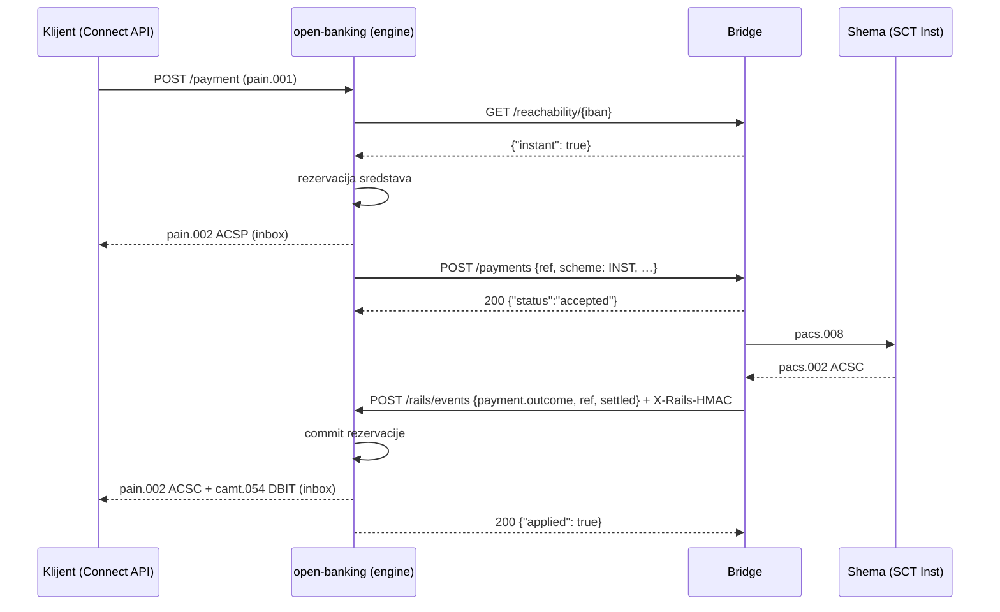

# Protokol prema bridgeu za sheme (HttpRails)

Ugovor između open-banking servera (`server/src/rails-http.ts`, `RAILS=http`) i vanjskog
procesa koji govori sa stvarnim shemama: SEPA SCT, SEPA Instant, Faster Payments, SWIFT,
TARGET2 i SEPA Direct Debit. JSON preko HTTP-a, potpisan dijeljenom tajnom. Odluke
930–938 u `docs/decisions.md`.

## Osnovno

- **Smjerovi.** Mi → bridge: `RAILS_URL` (npr. `http://bridge:9000/v1`), po želji drugi URL
  po shemi (`RAILS_URL_INST`, `RAILS_URL_FAST` …). Bridge → mi: `POST /rails/events` na
  zasebnom HTTP portu (`RAILS_CALLBACK_HOST:RAILS_CALLBACK_PORT`, zadano `127.0.0.1:8444`),
  ne na mTLS Connect API-ju. Oba su interna mreža.
- **Potpis.** Svaki zahtjev u oba smjera nosi `X-Rails-HMAC: hex(HMAC-SHA256(ključ = UTF-8
  RAILS_SECRET, poruka = sirovi bajtovi tijela))`, isti obrazac kao LHV-ov `X-LHV-HMAC`. GET
  potpisuje prazno tijelo. Pogrešan ili nepostojeći potpis: `401`, ništa se ne mijenja.
- **Iznosi** su decimalni stringovi s najviše dvije decimale (`"12.34"`), valuta ISO 4217.
- **Idempotencija po `ref`.** `ref` je naš AcctSvcrRef plaćanja (ili kolekcije). Ponovljen
  `POST /payments` s istim `ref` vraća trenutno stanje i ne šalje plaćanje drugi put.
  Ponovljen callback za isti ref je `200` i ne mijenja ništa. Iznimka: SEPA Instant koji je
  završio `unavailable`, a mi ga automatski šaljemo kao SEPA, dolazi **s istim `ref`** i
  `scheme: "SEPA"`; bridge ga mora tretirati kao novi pokušaj (ključ `ref` + `scheme`).
- **Ponavljanje.** Na mrežnu grešku ili `5xx` ponavljamo isti zahtjev (`retries`, zadano 2).
  Bridge na callback koji nije dobio `2xx` ponavlja dok ne dobije; `400` je trajna greška.

## Mi → bridge

| Poziv | Tijelo | Odgovor `200` |
| --- | --- | --- |
| `POST /payments` | `{ref, scheme, amount, currency, debtor: {name?, iban}, creditor: {name?, iban?, account?, sortCode?, accountNumber?, bic?}, endToEndId?, remittance?}` | `{"status":"accepted"}` (na čekanju u shemi), ili odmah `settled`, `{"status":"rejected","reason":"…"}`, `unavailable` |
| `POST /collections` | `{ref, amount, currency, creditor: {name?, iban}, debtor: {name?, iban, bic?}, endToEndId, mandateId?, settlementDate}` | `{"status":"settled"}` ili `{"status":"rejected","code":"AM04"}` (SEPA R-kod) |
| `GET /reachability/{iban}` | — | `{"instant": true\|false}` (je li račun dohvatljiv SEPA Instantom) |
| `GET /payments/{ref}` | — | stanje plaćanja; za rekoncilijaciju nakon restarta (odluka 934), mi ga još ne zovemo |

- `scheme`: `SEPA`, `INST`, `SWIFT`, `TARGET2`, `FAST`. Za Faster Payments na UK račun bez
  IBAN-a `creditor.account` je 14 znamenki, a dodajemo i `sortCode` (6) i `accountNumber` (8).
- `reason` u `rejected` ide klijentu doslovno u pain.002 `AddtlInf`; neka bude u LHV-ovom
  obliku (`"Account closed."`).
- `unavailable`: shema plaćanje nije mogla uzeti (Instant timeout, shema zatvorena).
  Automatski odabran INST tada ide kao SEPA (pain.002 ACWC), inače RJCT.
- Ako bridge nije dohvatljiv ni nakon ponavljanja ili odgovori izvan protokola: plaćanje je
  `unavailable` (RJCT `Technical problem. Try again`, sredstva oslobođena), reachability je
  `false` (ide SEPA). Rizik: ako naš `POST` istekne nakon što ga je bridge primio, mi
  plaćanje odbijamo, a bridge bi ga mogao izvršiti. Zato bridge odgovara odmah (unutar
  `RAILS_TIMEOUT_MS`, zadano 10 s) i plaćanje šalje u shemu tek nakon odgovora; za ref koji
  smo odbili kasniji `payment.outcome` dobiva `applied: false`, i to je signal za ručnu
  rekoncilijaciju (odluka 936).
- `collections` odgovara pri prezentaciji; povrati nakon namire (R-transakcije do 8 tjedana)
  i opozivi (camt.056) još nisu u protokolu (odluka 933).

## Bridge → mi: `POST /rails/events`

| `type` | Tijelo | Odgovor `200` |
| --- | --- | --- |
| `payment.outcome` | `{type, ref, outcome: {status: "settled"\|"rejected"\|"unavailable", reason?}}` | `{"applied": true}`; `false` za nepoznat ili već završen ref (duplikat, ignoriran) |
| `credit` | `{type, credit: {ref, iban, amount, currency, scheme, debtor: {name?, iban?, bic?, account?}, creditorName?, remittance?, reference?, endToEndId?}}` | `{"status":"booked","servicerRef":"…"}` ili `{"status":"returned","code":"AC01","reason":"…"}` |

- `credit.ref` je referenca sheme (bridgea): isti ref drugi put vraća prvi rezultat, ne
  knjiži ponovno. `iban` je IBAN, VIBAN ili agency račun (IBAN ili sort code + broj računa).
  `returned` znači da bridge vraća novac pošiljatelju s tim ISO kodom.
- Ostali odgovori: `401` loš HMAC, `400` tijelo izvan protokola, `503` server još ne sluša,
  `5xx` greška kod nas (bridge ponavlja).

## Tijek: SEPA Instant prihvaćen, pa namiren

Odbijanje ide istim putem s `rejected` (pain.002 RJCT, sredstva oslobođena). Callback koji
stigne prije odgovora na `POST /payments` vrijedi; kasniji `accepted` tada ne mijenja ništa.
